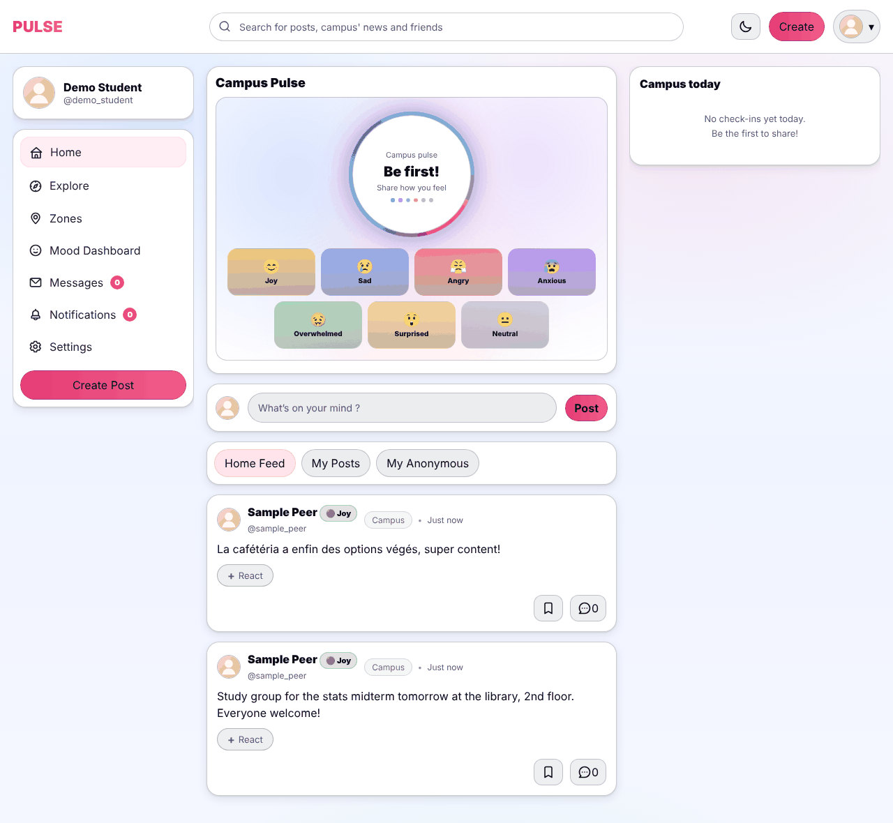
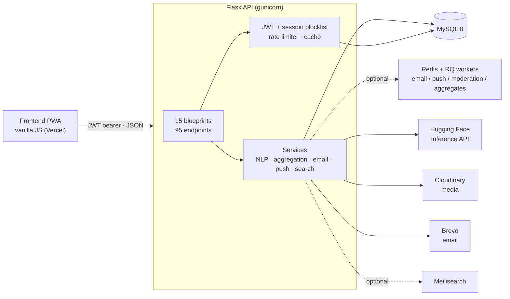
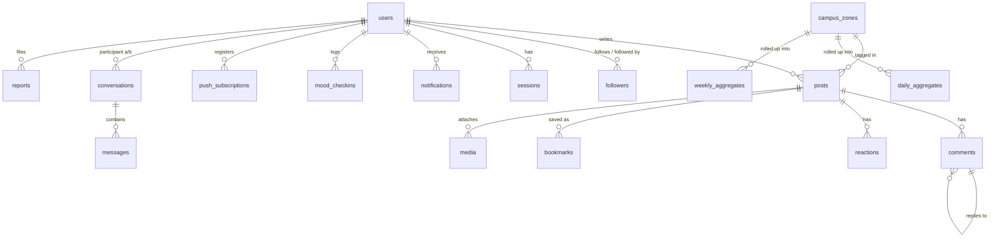

# PULSE

A privacy-first campus wellness platform for Université Laval. Students post how they feel, publicly or under a pseudonym, and the campus gets mood analytics that never expose anyone.

> **"Individual expression is private, collective insight is public."**

**Stack:** Python 3.12 · Flask 3 · SQLAlchemy · MySQL 8 · JWT · Redis/RQ (optional) · Hugging Face Inference API · vanilla JS PWA

<p align="center">
  
</p>
<p align="center">
  
</p>
<p align="center"><sub>Screenshots of a local run: the Flask backend started with its <code>testing</code> config on a throwaway SQLite file (no MySQL, no API keys) and the <code>Frontend/</code> folder served statically. The two accounts and the posts were created through the API for the screenshot; the emotion badges are what the backend assigned to them.</sub></p>

## The problem

Students rarely share stress or low mood when their name is attached, and asking about it directly gives no picture of how the campus as a whole is doing. PULSE separates two things:

- **Individual layer.** Each post is either public (on your profile) or anonymous (shown under a persistent pseudonym). The author's `user_id` is stored for moderation but never returned by the API for anonymous posts, and followers never see your anonymous posts.
- **Collective layer.** Every post is scored for sentiment and emotion in English or French. Scores are rolled up by day, week and campus zone. An aggregate is shown only once it covers **at least 10 posts**, so no single person's mood can be worked out from it.

Sign-up is limited to `@ulaval.ca` email addresses, and you must verify your email before you can post or comment.

## Features

- **Bilingual NLP.** `langdetect` identifies the language of each post. English posts are scored locally with VADER. French posts are classified by `cardiffnlp/twitter-xlm-roberta-base-emotion` through the Hugging Face Inference API, and fall back to VADER when no API key is set. No model weights are bundled.
- **Social layer.** Follows, mutual friends, emoji reactions (only counts are shown), comments with one level of replies and an edit window, `@mention` autocomplete, bookmarks, and one pinned post per profile.
- **Feeds.** The home feed mixes posts from people you follow with suggestions from accounts you don't, chosen by your interests and ranked by engagement and recency. There are also discovery, trending (cached) and per-zone feeds, plus 42 campus buildings seeded as zones.
- **Direct messages.** Text, images, video and voice notes, reply quoting, unsend, read receipts and unread counts.
- **Notifications.** In-app, by email (Brevo, bilingual) and Web Push (VAPID).
- **Moderation.** User reports, an admin review queue with hide and delete actions, an auto-flagged content queue, and audit logs.
- **Search.** One search across posts, users and zones, backed by SQL by default or by Meilisearch when that is enabled.
- **Account security.** bcrypt password hashing, TOTP 2FA with backup codes, a list of active sessions with remote revoke, password reset, account deactivation, and rate limits on login, posting, comments, reactions, messages and search.
- **Bilingual API.** Response messages are in French or English, depending on the `Accept-Language` header.

## Architecture



Background jobs go through `enqueue_task`. When Redis or RQ is not configured, the job simply runs inline, so the app works without either.

## API overview

There are **95 REST endpoints** (unique method and path pairs under `/api`), spread over 15 Flask blueprints. The count comes from Flask's `url_map`. Four of them, the OIDC and CAS login routes, return `503` unless `ENABLE_OIDC_AUTH=true`.

| Resource | Base path | # | Endpoints |
|---|---|---|---|
| Auth and account | `/api/auth` | 30 | `register`, `login`, `logout`, `me`, `change-password`, `forgot-password`, `reset-password`, `send-verification`, `resend-verification`, `verify-email/<token>`, `update-profile`, `update-bio`, `update-pseudonym`, `upload-profile-pic`, `upload-header`, `privacy-settings`, `preferences`, `sessions` (list / revoke one / revoke all), `2fa/{enable,verify,disable,backup-codes}`, `deactivate`, `reactivate`, `oidc/{login,callback}`, `cas/{login,callback}` |
| Posts and feeds | `/api/posts` | 13 | create, delete, `feed`, `discover`, `trending`, `me`, `me/anonymous`, `@<username>`, `zone/<id>`, pin / unpin, bookmark / unbookmark |
| Reactions | `/api/posts/<id>` | 3 | `react` (POST / DELETE), `reactions` |
| Comments | `/api` | 5 | `posts/<id>/comments` (POST / GET), `comments/<id>/replies`, `comments/<id>` (PATCH / DELETE) |
| Social graph | `/api` | 6 | `follow/@<u>`, `unfollow/@<u>`, `users/@<u>`, `users/@<u>/followers`, `users/@<u>/following`, `users/me/friends` |
| Direct messages | `/api/messages` | 9 | list / create conversations, get / send in a thread, `audio`, `media`, unsend, mark `read`, `unread-count` |
| Notifications | `/api/notifications` | 4 | list, mark one read, `read-all`, delete |
| Bookmarks | `/api/bookmarks` | 1 | list saved posts |
| Zones | `/api/zones` | 7 | list, `<id>`, `search`, `suggest`, `types`, `trending`, `<id>/activity` |
| Search | `/api/search` | 2 | unified search, `users` (mention autocomplete) |
| Analytics | `/api/analytics` | 3 | `daily`, `weekly`, `campus` |
| Mood check-ins | `/api/mood` | 2 | `checkin`, `pulse` (distribution) |
| Moderation | `/api` | 5 | `reports`, `admin/reports`, `admin/reports/<id>`, `admin/posts/<id>`, `admin/flagged` |
| Web Push | `/api/push` | 4 | `vapid-public-key`, `subscribe`, `subscribe/<id>`, `test` |
| Uploads | `/api/upload` | 1 | generic authenticated upload to Cloudinary |
| **Total** | | **95** | |

## Auth model

| Level | How it is enforced | Applies to |
|---|---|---|
| Public | none | register, login, password reset, email verification, all `/zones/*` reads, reading comments, VAPID public key |
| Authenticated | `@jwt_required()`, with `Authorization: Bearer <token>` | most endpoints |
| Verified | `@require_verification` (email confirmed) | creating posts and comments |
| Admin | `@require_admin` (`users.is_admin`) | `/api/admin/*` moderation routes |

- **Tokens.** HS256 JWTs (Flask-JWT-Extended) that last 24 hours by default (`JWT_ACCESS_TOKEN_EXPIRES`). There is no refresh token.
- **Revocation.** Each login creates a row in `sessions` that stores the token's `jti`. A JWT blocklist callback rejects tokens whose session was revoked or has expired, and caches valid tokens for 30 seconds so most requests skip the database.
- **2FA.** If TOTP is enabled, `login` answers `requires_2fa: true` until the request includes a valid `totp_code` or `backup_code`.
- **Rate limits.** Flask-Limiter, keyed by user ID when a token is present and by IP otherwise. Examples: login 10/min, posts 15/h, comments 20/h, messages 60/h.

## Data model

MySQL 8 with `utf8mb4` (needed for emoji reactions). The schema is in [`backend/schema.sql`](backend/schema.sql); SQLAlchemy models are in `backend/app/models/`.



Key columns: `users.pseudonym` and `pseudonym_last_changed` (90-day cooldown), `users.totp_secret`, `users.is_admin`; `posts.is_anonymous`, `sentiment_score` (from -1 to 1), `sentiment_label`, `emotion_label`, `detected_language`, `is_flagged`. `security_logs` records authentication and moderation events.

## Quickstart

**Prerequisites:** Python 3.12+ and MySQL 8. Email delivery needs a [Brevo](https://www.brevo.com/) API key and media uploads need a [Cloudinary](https://cloudinary.com/) account; both are optional for a local tour. Redis is optional.

### 1. Backend

```bash
git clone https://github.com/mo-dev-x/pulse.git
cd pulse/backend

python3 -m venv venv
source venv/bin/activate          # Windows: venv\Scripts\activate
pip install -r requirements.txt

cp .env.example .env              # fill in SECRET_KEY, JWT_SECRET_KEY and the MYSQL* variables

python setup_db.py                # interactive: creates the database, applies schema.sql, seeds campus zones
python run.py                     # http://127.0.0.1:5000
```

All the configuration variables are listed, with comments, in [`backend/.env.example`](backend/.env.example). Only `SECRET_KEY`, `JWT_SECRET_KEY` and the `MYSQL*` variables are needed to boot.

Production runs on gunicorn (see [`backend/Procfile`](backend/Procfile)):

```bash
gunicorn run:app --bind 0.0.0.0:$PORT --workers 1 --threads 4 --timeout 60
```

### 2. Frontend

```bash
cd pulse/Frontend
python3 -m http.server 8000       # ES modules need http://, not file://
# open http://127.0.0.1:8000/login.html
```

When served from `localhost`, the frontend uses `http://127.0.0.1:5000` as its API. On any other host it uses the deployed Railway backend (see `Frontend/js/auth.js`).

### 3. Example requests

```bash
# Register (must be an @ulaval.ca address; password needs 8+ chars with upper, lower and digit)
curl -s -X POST http://127.0.0.1:5000/api/auth/register \
  -H "Content-Type: application/json" \
  -d '{"email":"jane.doe@ulaval.ca","password":"SecurePass123","username":"janedoe"}'
# -> 201 {"message": ..., "user": {...}, "token": "<JWT>", "verification_email_sent": false}

TOKEN="<JWT from the response>"

# Who am I?
curl -s http://127.0.0.1:5000/api/auth/me -H "Authorization: Bearer $TOKEN"

# Public endpoint: campus zones
curl -s http://127.0.0.1:5000/api/zones

# Post anonymously (requires a verified account; without Brevo configured,
# set users.is_verified = 1 for your user in MySQL)
curl -s -X POST http://127.0.0.1:5000/api/posts \
  -H "Authorization: Bearer $TOKEN" -H "Content-Type: application/json" \
  -d '{"content":"Exam week is rough, but the library is calm today","is_anonymous":true,"zone_id":1}'

# Campus mood for a day (returned only when at least 10 posts are aggregated)
curl -s "http://127.0.0.1:5000/api/analytics/campus?date=2026-04-07" -H "Authorization: Bearer $TOKEN"
```

Add `-H "Accept-Language: fr"` to get the messages in French.

## Tests

```bash
cd backend
pip install pytest
python -m pytest tests/ \
  --ignore=tests/test_auth.py --ignore=tests/test_posts.py --ignore=tests/test_reactions.py \
  --ignore=tests/test_analytics.py --ignore=tests/test_social.py --ignore=tests/test_nlp_camembert.py
```

There are two kinds of tests:

- **In-process suites.** Most files in `backend/tests/` (2FA, sessions, messages, search, reports, rate limiting, caching, background jobs and others) use Flask's test client with in-memory SQLite (`create_app('testing')`), so they need no external services.
- **HTTP scripts.** `test_auth.py`, `test_posts.py`, `test_reactions.py`, `test_analytics.py` and `test_social.py` are scripts that call a running server at `127.0.0.1:5000` backed by MySQL. Run them with `python tests/test_auth.py` while `python run.py` is running. `test_nlp_camembert.py` exercises the NLP service directly.

Current state: the in-process suites give **79 passing and 23 failing** tests. The failures are mostly in comments, reports, bookmarks and caching, where tests still patch `app.routes.posts.analyze_sentiment`, a function the code no longer has after the switch to the Hugging Face NLP service. The tests need updating; the endpoints themselves are not known to be broken.

## Project structure

```text
pulse/
├── backend/
│   ├── app/
│   │   ├── __init__.py        # app factory: extensions, CORS, JWT blocklist, blueprints, error handlers
│   │   ├── config.py          # env-driven config (development / production / testing)
│   │   ├── routes/            # 15 blueprints (auth, posts, social, messages, analytics, ...)
│   │   ├── models/            # SQLAlchemy models
│   │   ├── services/          # NLP, aggregation, email, push, search, sessions, TOTP, job queue
│   │   ├── tasks/             # RQ job entry points (email, push, moderation, NLP, aggregates)
│   │   ├── middleware/        # require_verification, require_admin
│   │   └── utils/             # i18n messages, Cloudinary helpers
│   ├── tests/
│   ├── scripts/               # populate_campus_zones.py, reindex_meilisearch.py
│   ├── documentation/         # ADRs, phase write-ups, technical guides
│   ├── schema.sql
│   ├── setup_db.py
│   ├── run.py
│   ├── Procfile
│   └── requirements.txt
└── Frontend/                  # vanilla JS PWA (HTML/CSS/ES modules, service worker, Vercel config)
```

More documentation:

- [`backend/QUICKSTART.md`](backend/QUICKSTART.md): detailed backend setup.
- [`backend/documentation/ARCHITECTURE_DECISIONS.md`](backend/documentation/ARCHITECTURE_DECISIONS.md): design decisions.
- [`backend/documentation/Technical/`](backend/documentation/Technical/): guides on messaging, moderation, search, rate limiting, OIDC and more.
- [`Frontend/QUICKSTART.md`](Frontend/QUICKSTART.md): frontend notes.

## Limitations and roadmap

- **University SSO is off.** The OIDC (Azure Entra) login is written but disabled behind `ENABLE_OIDC_AUTH` until the university grants access. Sign-up uses email verification for now.
- **No refresh tokens.** Users log in again after the 24-hour JWT expires. The frontend keeps the token in `localStorage`; moving it to httpOnly cookies is on the hardening list.
- **Schema changes are not versioned.** Changes are applied as idempotent `ALTER TABLE` statements when the app boots (`_migrate_schema`), not through a migration tool such as Alembic.
- **Rate limits use in-memory storage**, so they are not shared across gunicorn workers. Production currently runs a single worker.
- **Some test suites are out of date** (see Tests), and there is no CI yet.
- The `events` table in `schema.sql` has no model or endpoints yet.

## Team

- Backend and API: Mohamed El Yazid El Yaakoubi ([@mo-dev-x](https://github.com/mo-dev-x))
- Frontend: Principessa

## License

No license has been chosen yet.
